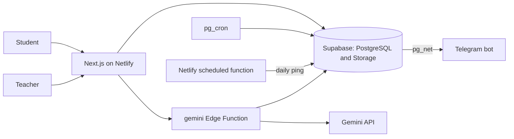

# M&R Academia

[Español](README.md) · **English**

A web booking system for private tutoring: students pick a day and time, pay by bank transfer and upload the receipt; teachers confirm each booking from their own dashboard.

**Live site:** [clasesparticulares-m-g.netlify.app](https://clasesparticulares-m-g.netlify.app/)
(booking requires a national ID number registered by a teacher)

I designed, built and shipped it end to end for a real client, with the goal of running at **$0 per month** on free plans.

> The interface is in Spanish because it serves students in Argentina.

## Features

### For students
- Five-step, mobile-friendly booking with no account: students identify themselves with their national ID number (DNI).
- Calendar with live availability, multi-hour consecutive bookings and an optional final half hour.
- Receipt and study-notes upload (PDF, photos or Word): photos are compressed in the browser and duplicate files are detected by their content.
- The page theme changes according to the teacher of the selected subject.

### For teachers
- Weekly **schedule** showing the students in each time slot.
- **Bookings:** view the receipt, confirm, reject or cancel, and notify the student through a pre-written WhatsApp message.
- **Time slots and students:** manage availability, and register or block students.
- **Telegram alerts** when a receipt arrives, plus automatic reminders to load time slots and clean up files.
- **AI-generated material:** Gemini creates theory and exercises from the student's notes, with a chat to request adjustments.
- **Cleanup** of old files to stay within the free storage quota.

## Architecture



| Area | Technology |
|---|---|
| Frontend | Next.js 16 (App Router), React 19, Tailwind CSS 4, JavaScript |
| Database | Supabase (PostgreSQL), SQL functions, Row Level Security |
| Auth and files | Supabase Auth and Storage |
| Scheduled jobs | pg_cron, pg_net and Netlify Scheduled Functions |
| AI | Gemini API through a Supabase Edge Function (Deno) |
| Hosting | Netlify |

## Technical decisions

- **Business rules live in the database.** The `crear_reserva` function validates time slots, capacity and advance notice, and saves everything in a single transaction. The browser cannot write directly to the booking tables.
- **No overbooking.** I verified this with [concurrency tests](pruebas/): when three students book the last spot at the same time, only one gets it.
- **Protected personal data.** Every table uses RLS. Checking an ID number returns only the student's first name, and failed attempts are rate-limited per IP to prevent guessing.
- **Private files.** Storage buckets are private and files get random names. Visitors can upload files, but cannot read, replace or delete them.
- **Automatic expiration.** If a booking is not confirmed within 30 minutes, `pg_cron` releases its spots and flags the payment for refund.
- **Gemini in an Edge Function.** With large notes, Gemini took longer than Netlify functions allow. I moved the call to Supabase, which supports longer requests, and added a fallback model for when the main one is overloaded.
- **Privacy with AI.** Gemini receives the subject, school year, notes and study material; never the student's name, ID number or phone number.

## Project structure

```text
src/
  app/                  Pages (home, /reservar, /admin) and the /api/limpieza route
  components/           Booking steps
  components/admin/     Teacher dashboard tabs
  lib/                  Supabase, files, dates and WhatsApp messages
supabase/
  001 to 023_*.sql      Scripts that recreate the database, in order
  functions/gemini/     Edge Function that talks to Gemini
netlify/functions/      Daily ping that keeps Supabase from pausing
pruebas/                Concurrency and invalid-booking tests
docs/                   Project plan and decisions (in Spanish)
```

## Running locally

You need [Node.js](https://nodejs.org/) 20.9 or later and a [Supabase](https://supabase.com/) project.

1. **Clone the repository and install dependencies:**

   ```bash
   git clone https://github.com/Ian-M-09/sistema-turnos-clases.git
   cd sistema-turnos-clases
   npm install
   ```

2. **Set up the database:** run the scripts in `supabase/` in order from the SQL Editor. Each one is described in [supabase/README.md](supabase/README.md) (in Spanish).

3. **Create a `.env.local` file** in the project root:

   ```env
   NEXT_PUBLIC_SUPABASE_URL=https://your-project.supabase.co
   NEXT_PUBLIC_SUPABASE_ANON_KEY=your-public-key
   SUPABASE_SERVICE_ROLE_KEY=your-secret-key
   ```

   `SUPABASE_SERVICE_ROLE_KEY` is used only on the server, for file cleanup. Never publish it or give it the `NEXT_PUBLIC_` prefix.

4. **Start the project:**

   ```bash
   npm run dev
   ```

   Open [http://localhost:3000](http://localhost:3000).

### Optional integrations

| Integration | What it needs |
|---|---|
| AI material | Deploy `supabase/functions/gemini` and add `GEMINI_API_KEY_1` and `GEMINI_API_KEY_2` to its secrets (one key per teacher) |
| Telegram alerts | Store the bot token in Supabase Vault as `telegram_bot_token` (or one per teacher: `telegram_bot_token_1` and `telegram_bot_token_2`) and add each teacher's `chat_id` to `telegram_profesores` |

## Author

Built by **Ian Miño**, Computer Engineering student.

[Portfolio](https://ian-m-09.github.io/) · [GitHub](https://github.com/Ian-M-09)
