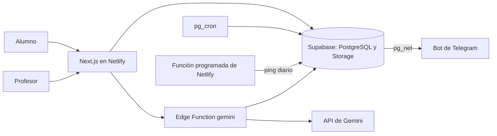

# ClasesParticulares.M-R

**Español** · [English](README.en.md)

Sistema web de reservas para clases particulares: los alumnos eligen día y horario, pagan por transferencia y suben el comprobante; los profesores confirman cada reserva desde un panel propio.

**Sitio en producción:** [clasesparticulares-m-g.netlify.app](https://clasesparticulares-m-g.netlify.app/)
(para reservar hace falta un DNI registrado por un profesor)

Lo diseñé, desarrollé y publiqué de punta a punta, para una clienta real, con el objetivo de que funcione con **costo mensual de $0** usando planes gratuitos.

## Funcionalidades

### Para los alumnos
- Reserva en 5 pasos desde el celular, sin crear una cuenta: se identifican con su DNI.
- Calendario con disponibilidad real, reservas de varias horas seguidas y media hora final opcional.
- Subida de comprobante y apuntes (PDF, fotos o Word): las fotos se comprimen en el navegador y los archivos repetidos se detectan por su contenido.
- La página cambia de colores según el profesor de la materia elegida.

### Para los profesores
- **Agenda** semanal con los alumnos de cada horario.
- **Reservas:** ver el comprobante, confirmar, rechazar o cancelar, y avisar al alumno por WhatsApp con el mensaje ya escrito.
- **Horarios y alumnos:** carga de disponibilidad, registro y bloqueo de alumnos.
- **Avisos por Telegram** al llegar un comprobante, y recordatorios automáticos para cargar horarios y limpiar archivos.
- **Material con IA:** Gemini genera teoría y ejercicios a partir de los apuntes del alumno, con un chat para pedir ajustes.
- **Limpieza** de archivos viejos para no superar el almacenamiento gratuito.

## Arquitectura



| Área | Tecnología |
|---|---|
| Frontend | Next.js 16 (App Router), React 19, Tailwind CSS 4, JavaScript |
| Base de datos | Supabase (PostgreSQL), funciones SQL, Row Level Security |
| Autenticación y archivos | Supabase Auth y Storage |
| Tareas programadas | pg_cron, pg_net y Netlify Scheduled Functions |
| Inteligencia artificial | API de Gemini desde una Supabase Edge Function (Deno) |
| Hosting | Netlify |

## Decisiones técnicas

- **Las reglas viven en la base de datos.** La función `crear_reserva` valida horarios, cupos y anticipación, y guarda todo en una sola transacción. El navegador no puede escribir directamente en las tablas de reservas.
- **Sin sobreventa de lugares.** Lo comprobé con [pruebas de concurrencia](pruebas/): con tres alumnos reservando a la vez el último lugar, solo entra uno.
- **Datos personales protegidos.** Todas las tablas tienen RLS. Verificar un DNI devuelve solo el nombre, y cada IP tiene un límite de intentos fallidos para evitar que se prueben DNIs al azar.
- **Archivos privados.** Los buckets son privados y los archivos tienen nombres aleatorios. Los visitantes pueden subirlos, pero no leerlos, reemplazarlos ni borrarlos.
- **Vencimiento automático.** Si una reserva no se confirma en 30 minutos, `pg_cron` libera los lugares y la marca para devolver el pago.
- **Gemini en una Edge Function.** Con apuntes pesados, Gemini tardaba más de lo que permiten las funciones de Netlify. Moví la llamada a Supabase, que admite pedidos más largos, y agregué un modelo de respaldo por si el principal está saturado.
- **Privacidad con la IA.** A Gemini se le envían la materia, el año, las notas y los apuntes; nunca el nombre, el DNI ni el teléfono del alumno.

## Estructura

```text
src/
  app/                  Páginas (inicio, /reservar, /admin) y ruta /api/limpieza
  components/           Pasos de la reserva
  components/admin/     Pestañas del panel de profesores
  lib/                  Supabase, archivos, fechas y mensajes de WhatsApp
supabase/
  001 a 023_*.sql       Scripts para recrear la base de datos, en orden
  functions/gemini/     Edge Function que se comunica con Gemini
netlify/functions/      Ping diario para que Supabase no se pause
pruebas/                Pruebas de concurrencia y de reservas inválidas
docs/                   Plan de trabajo y decisiones del proyecto
```

## Cómo correrlo en local

Necesitás [Node.js](https://nodejs.org/) 20.9 o superior y un proyecto de [Supabase](https://supabase.com/).

1. **Cloná el repositorio e instalá las dependencias:**

   ```bash
   git clone https://github.com/Ian-M-09/sistema-turnos-clases.git
   cd sistema-turnos-clases
   npm install
   ```

2. **Prepará la base de datos:** corré los scripts de `supabase/` en orden, desde el SQL Editor. El detalle de cada uno está en [supabase/README.md](supabase/README.md).

3. **Creá el archivo `.env.local`** en la raíz del proyecto:

   ```env
   NEXT_PUBLIC_SUPABASE_URL=https://tu-proyecto.supabase.co
   NEXT_PUBLIC_SUPABASE_ANON_KEY=tu-clave-publica
   SUPABASE_SERVICE_ROLE_KEY=tu-clave-secreta
   ```

   `SUPABASE_SERVICE_ROLE_KEY` se usa solo en el servidor, para la limpieza de archivos. Nunca la publiques ni le pongas el prefijo `NEXT_PUBLIC_`.

4. **Iniciá el proyecto:**

   ```bash
   npm run dev
   ```

   Abrí [http://localhost:3000](http://localhost:3000).

### Integraciones opcionales

| Integración | Qué hace falta |
|---|---|
| Material con IA | Desplegar `supabase/functions/gemini` y cargar en sus secretos `GEMINI_API_KEY_1` y `GEMINI_API_KEY_2` (una clave por profesor) |
| Avisos por Telegram | Guardar el token del bot en Supabase Vault como `telegram_bot_token` (o uno por profesor: `telegram_bot_token_1` y `telegram_bot_token_2`) y cargar el `chat_id` de cada profesor en `telegram_profesores` |

## Autor

Desarrollado por **Ian Miño**, estudiante de Ingeniería en Informática.

[Portfolio](https://ian-m-09.github.io/) · [GitHub](https://github.com/Ian-M-09)
